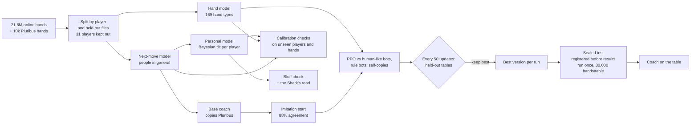

# Poker Mirror: sources for the slides

Everything [SLIDES.md](SLIDES.md) quotes, with the file it comes from, plus the images, a flow chart and a glossary.
Paths are relative to the repository root.

## Files to use for the presentation

| File | Use it for |
|---|---|
| [DEMO.md](../../DEMO.md) | What is on screen, the 4-minute demo, the numbers to quote, answers to the judges' questions |
| [train/TRAINING.md](../../train/TRAINING.md) | What each model was trained on and why; the RL policy in detail; every run |
| [train/06_eval_and_overfitting.md](../../train/06_eval_and_overfitting.md) | The sealed test: registered before any result, every result, the 30,000-hand table |
| [PROGRESS.md](../../PROGRESS.md) | The build story by time; "Key results so far" holds the early data analysis (slide 2) |
| [judges/hrt.md](../../judges/hrt.md), [judges/g-research.md](../../judges/g-research.md) | What the judges score |
| [README.md](../../README.md) | One-paragraph description and how to run it |
| `docs/slides/img/*.png` | Screenshots (below) |
| [docs/slides/PokerMirror.pptx](PokerMirror.pptx) | The deck: 5 slides with speaker notes; rebuild with `python docs/slides/build_deck.py` (needs python-pptx) |

## Numbers and where they come from

### Slide 2: early data analysis (heads-up river decisions)

| Number | Source |
|---|---|
| 0 of 4,156 offers with cards shown were folds | `PROGRESS.md` "At a glance"; `data/mirror/scan_counts.json` |
| Person vs population: +0.0028 nats, 95% CI [+0.0002, +0.0060] (22,320 river offers) | `data/mirror/eval.json` |
| Type prior: +0.0020, CI [−0.0052, +0.0084]; types + history vs history: +0.0005, CI [−0.0011, +0.0020] | `data/mirror/styles.json` → `gate` |
| Situation vs average player +0.0253 nats, CI [+0.0229, +0.0280]; history on top +0.0017, CI [+0.0010, +0.0025] (157,926 decisions) | `data/mirror/eval_wide.json` |
| Pluribus: mean defender equity fold 0.51 < call 0.74 < raise 0.84 (701 spots) | `data/mirror/eval.json` → `pluribus` |
| Bot tuned to one opponent minus average-trained bot, chips per spot: folder +8.00 [+6.10, +10.05], caller +4.55 [+2.00, +7.15], average −2.75 [−4.40, −1.10] | `data/mirror/benchmark.json` |

### Slides 3–5: the models and the table

| Number | Source |
|---|---|
| 21.6M hands; online venues PokerStars, iPoker, PartyPoker, Full Tilt, Absolute; 10,000 Pluribus hands | `train/TRAINING.md` § The data |
| Next move: says 75% → happens 76%, 670,615 decisions, error 0.008 | `data/demo/calibration.json` |
| Personal model on 30 unseen players: 68.8% vs 67.4% (people) vs 64.7% (usual move); +1.3 ± 1.2 points; sharper for 28 of 30 | `data/demo/unseen_players_eval.json` |
| Hand model: top 10 16% vs 8% card counting; after the flop 29% vs 5% (44,036 guesses) | `data/demo/calibration.json` |
| Zones on this table's players: 48 / 79 / 90% inside 50 / 80 / 90% | `data/demo/grid_on_bots_widened.json` |
| Bluff check (fresh session): "everyone folds" 30.1% said / 27.7% happened (871 bets); each player 68.1% / 67.6% (1,947 answers) | `data/demo/bluff_calibration.json`; fit in `data/demo/bluff_fit.json` |
| 10,213 regulars (1,000+ hands); extreme 15% of each type | `data/demo/player_types.json` |
| Bots vs real (VPIP / PFR / AF): TAG 17/15/4.3 vs 16/13/4.6; LAG 33/23/4.8 vs 36/27/4.8; LP 39/10/1.7 vs 42/11/1.6; TP 16/5/1.9 vs 15/5/1.4 | `data/demo/type_tilts.json` |
| The Shark: heads-up bets 26% (hands 1–10) → 52% (hands 51–60) vs 31% not reading; you fold 83%; no chip loss claimed (3.0 ± 1.4 vs 3.2 ± 1.3) | `data/demo/sim_you_shark.json` → `shark` |
| RL coach (sealed, 30,000 hands per table): +155.7 ± 15.1 vs equity bot; +153.8 ± 13.6 over imitation-only; range inputs +82.4 ± 13.6; style inputs −0.5 ± 14.5 | `data/rl/sealed_eval_30k.json` |
| Sealed test registered at 03:20, candidates frozen at 05:57, every result reported | `train/06_eval_and_overfitting.md` |
| RL settings: 193 inputs, 512-512-256, 7 actions, 65,536 decisions per update, clip 0.2, GAE λ 0.95 | `train/TRAINING.md` § The RL policy in detail; `data/rl/policy.json` |
| Imitation start agrees with Base 88% | `train/TRAINING.md` |

### Training curves (held-out bb/100 by update, for a line chart on slide 5)

| Run | 50 | 100 | 150 | 200 | 250 | 300 |
|---|---|---|---|---|---|---|
| v3-bc (shipped: update 50) | +150 | +138 | +68 | +38 | | |
| v3-bc-s2 (no leash) | +89 | +121 | +77 | +61 | −11 | |
| v3-bc-kl10 (leash 0.1) | +106 | +123 | +136 | +126 | +135 | |
| v3-bc-kl30 (leash 0.3) | +71 | +87 | +78 | +104 | +95 | |
| v3-noranges-s2 (scratch) | +90 | +152 | +186 | +141 | +211 | +167 |

Source: `data/rl/remote/<run>/eval.json` and `data/rl/runs/v3-noranges-s2/eval.json`, also logged in
`train/06_eval_and_overfitting.md`. Held-out scores swing by ±60–100. They pick each run's best version; the sealed
test is the clean measure.

## Images (`docs/slides/img/`, 2880×1800)

| File | Shows | Slide |
|---|---|---|
| `table_holecard_cam.png` | The table with the hole-card cam: every card shown to the audience, tagged "hidden from the models"; player types under the names | 1 |
| `your_move_bluff_check.png` | Coaches (Base, RL), size buttons, the bluff check in plain words, the real hand placed in our guess | 4 |
| `scorecard.png` | "How good are the guesses?": every result next to its baseline | 5 |
| `shark_replay_card.png` | The replay card: "The Shark learns you" | 5 (optional) |
| `shark_fast_forward.png` | The fast-forward: the model of you learning your leak | 5 (optional) |
| `shark_end_screen.png` | The end screen: 86% fold, the Shark's bets 26% → 52% vs 31% | 5 |

## Flow chart (training and evaluation)

## Glossary (for slide text)

- **VPIP:** share of hands a player voluntarily puts money in before the flop (loose vs tight).
- **PFR:** share of hands they raise before the flop.
- **AF:** after the flop, bets and raises per call (aggressive vs passive).
- **bb/100:** big blinds won per 100 hands.
- **Held-out:** data or opponents the model never trained on.
- **Sealed test:** a test written down before any result and run once.
- **Calibrated:** when it says 75%, it happens about 75% of the time.
- **Range:** the set of hands a player might hold, with their likelihoods.
- **Imitation start:** first copying an expert policy, then improving it with RL.
- **Leash (KL penalty):** a cost for drifting away from that expert policy.
